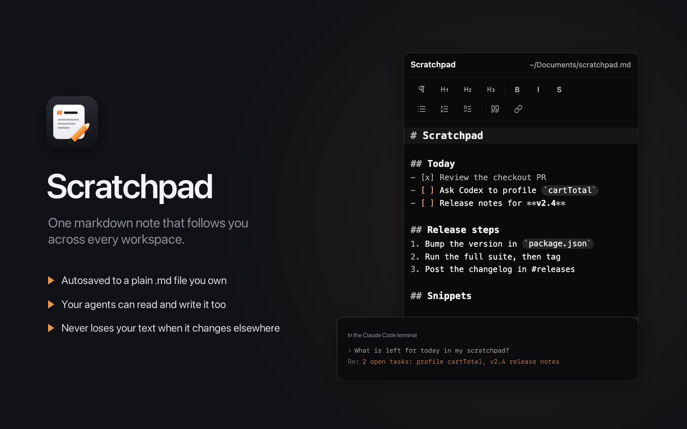

# Scratchpad



An Orca plugin that adds a right-sidebar panel to edit one global markdown scratchpad: a quick place for notes, snippets and drafts that follows you across every workspace. It requires Orca 1.4.246 or later and was tested on macOS with Orca 1.4.262.

## Install

From the command line:

```sh
orca plugin install eRom/orca-plugin-human-scratchpad
```

Orca shows the access the plugin asks for (see below) and enables it once you approve. The **Scratchpad** panel then appears in the right sidebar.

## Access requested, and why

- **`trusted-worker`**: the plugin reads and writes a single markdown file that lives outside any workspace, so it needs a worker with file access. It makes no network request and touches no other file.
- **`settings:own`**: the "Scratchpad file" setting, to use another file than the default one.
- **`storage:own`**: the panel's own state, in Orca's private storage for the plugin: the cursor and scroll position, and a draft of your text while saving is paused (see [How it behaves](#how-it-behaves)).

## Where the file lives

By default `~/orca-scratchpad.md` in your home folder (macOS, Linux and Windows). To use another file, open Settings, then Scratchpad, then "Scratchpad file". The path accepts `~` and must end with `.md`.

## How it behaves

- Autosave 300 ms after your last keystroke, and at least every 0.3 seconds while you keep typing.
- The file is checked for external changes every 2 seconds. If you have no unsaved changes, the new content is applied silently.
- If the file changed elsewhere while you have unsaved changes, a "Changed elsewhere" banner offers "Keep mine" or "Reload".
- While saving is paused (conflict banner, file full, or a failed write), the footer says "Not saved" and your text is kept as a draft in the plugin's private storage. If the panel is closed or reloaded in that state, the draft comes back with its banner. It is cleared as soon as the text is saved, or once you pick "Reload" or "Keep mine".

## Known limits

- The file is capped at 50 KB. Past that, saving pauses with a banner and the text stays in the editor, kept as a draft (see above). A draft above about 250 KB does not fit in Orca's private storage: it is not kept, and closing the panel then discards it.
- No rendered preview and no images in v1.
- No formatting shortcuts, because Orca keeps Cmd+B and Cmd+K.
- The undo history resets when the right sidebar switches tab or closes.
- A keystroke made less than about 0.3 s before switching sidebar tab or closing it can be lost: Orca destroys the panel without any exit event (measured). Typing is written at least every 0.3 s, so the loss window is about 0.3 s, not the whole burst.
- While saving is paused, the draft survives a panel reload, but it is written about 0.3 s after your last keystroke, with the same window.

## For agents

Your agents can use the same file. `skills/orca-scratchpad/SKILL.md` teaches an agent to read it and to append to it, never rewriting what is already there. Install it by copying the `orca-scratchpad` folder into your agent's skills folder, for example `~/.claude/skills/` for Claude Code. Orca does not ship plugin skills yet.

## Uninstall

```sh
orca plugin uninstall <plugin-key>
```

The key is the one shown by `orca plugin list`. Uninstalling removes the plugin and its approval. Your scratchpad file is never deleted: it stays where it is.

## Development

```
bun install
orca plugin types .      # tsconfig extends the git-ignored .orca/types
bun run build
orca plugin test .
orca plugin validate .
```

## License

MIT. The bundled panel includes CodeMirror and Lezer (MIT) and lucide icons (ISC, plus MIT for the Feather-derived icons): see `THIRD_PARTY_NOTICES.md` for their license texts.
